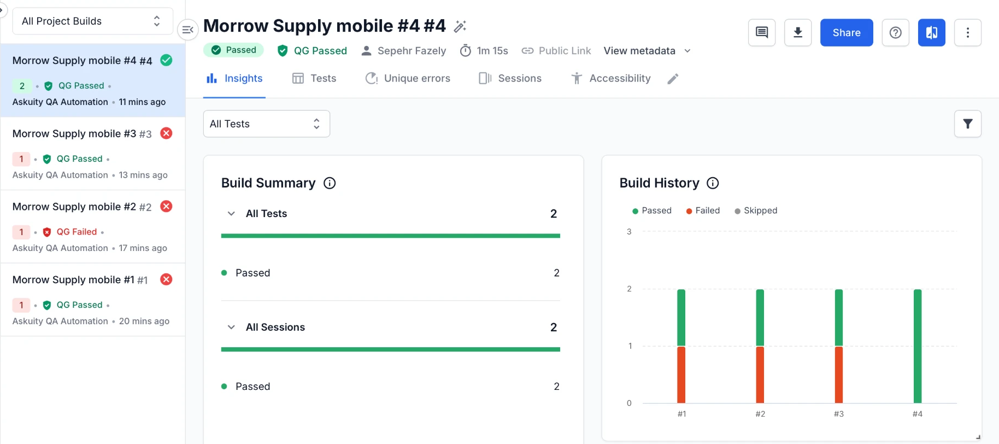

# Askuity QA Automation Exercise

Automated tests for the Morrow Supply shopping cart (https://qa-task--oyettijon.replit.app), written in
TypeScript with WebdriverIO 9, Mocha and the Page Object Model.

There are 57 desktop tests and 5 mobile tests, which run on 3 screen sizes. I found 9 bugs, written up in
[BUGS.md](BUGS.md).

## Quick start

You need Node.js 20.19 or newer and Chrome.

```bash
npm install
npm run test:stable
```

Other commands:

```bash
npm test              # full desktop suite, including the tests that expose bugs (these fail)
npm run test:stable   # desktop suite without the known-bug tests (all should pass)
npm run test:bugs     # only the known-bug tests
npm run test:mobile   # mobile tests at iPhone SE, Pixel 7 and iPad Mini sizes
npm run test:browserstack  # the mobile tests on real devices (needs a BrowserStack account)
npm run test:smoke    # quick check of the main flow
npm run report        # open the Allure report for the last run
```

To run one file: `npx wdio run config/wdio.desktop.conf.ts --spec src/specs/desktop/cart.spec.ts`

Headless mode, the browser and the number of parallel workers can be changed with environment variables.
See `.env.example`.

## My approach

Before writing tests I went through the app to see how it behaves. Two things shaped the framework:

- The app keeps the login and the cart in memory only, so reloading the page logs you out. Every test
  starts by loading the login page, which gives it a clean state. Tests don't depend on each other, so
  the spec files can run in parallel.
- Almost every element has a `data-test` attribute, so I used those as locators. They don't change when
  the styling or the text changes.

How the code is organised:

- `src/pages`: one page object per page, plus small components for repeated parts (header, product card,
  cart row). Tests call things like `CartPage.item(product).increase()` instead of using selectors.
- `src/flows`: common multi-step actions, like logging in or adding several items to the cart.
- `src/data`: test data and expected values (product catalogue, users, tax rate, messages). Expected
  values come from here, not from the page, so a wrong price on screen gets caught.
- `src/support`: helpers for selectors, waits, prices and logging.
- `src/specs`: the tests.
- `config`: WebdriverIO settings for desktop and mobile.

Other decisions:

- No fixed sleeps. Each wait checks for something real, for example the cart badge changing after
  "Add to Cart". ESLint blocks `browser.pause()` and missing `await`s.
- Prices are calculated in cents to avoid floating-point errors, and tax is rounded to the nearest cent.
- Shipping details are random for each run (generated with Faker) and written to the log.
- Every failed test saves a screenshot to `reports/screenshots` and adds it to the Allure report.

## Tests that find bugs

When a test finds a bug, I kept it asserting the correct behaviour, so it fails until the bug is fixed.
These tests are tagged `@known-bug` with the bug ID, for example `@known-bug BUG-002`.
`npm run test:stable` skips them and `npm run test:bugs` runs only them.

I also kept bugs from blocking unrelated tests. "Bolt T-Shirt" can't be added to the cart (BUG-002), so
the happy-path tests use other products and one separate test covers that bug.

The GitHub Actions workflow follows the same split: the stable desktop and mobile suites have to pass, and
the known-bug suite runs without blocking.

## Mobile

The mobile tests use Chrome device emulation (screen size, pixel ratio, touch and user agent) for iPhone SE
(375px), Pixel 7 (412px) and iPad Mini (768px). They reuse the desktop page objects and also check the
layout: no sideways scrolling, the right number of product columns for the width, and the header switching
to icons on phones.

The same tests also run on real devices in BrowserStack: an iPhone 17 with Safari and a Samsung Galaxy S25
with Chrome. This needs a BrowserStack account. Put your username and access key in `.env` (see
`.env.example`), then run `npm run test:browserstack`. In GitHub Actions this job only runs when started by
hand, because device minutes are limited.



Runs #1 to #3 each failed on one phone. On Android the on-screen keyboard swallowed the Login tap, and the
iPhone and Android drivers read drop-down values differently. Both were fixed in the test code, and run #4
passed on both phones.

How I'd approach mobile testing at a larger scale:

- Emulation on every push, because it's fast and free.
- Real devices on a cloud device farm (BrowserStack or Sauce Labs) nightly or before a release, choosing
  devices based on what customers actually use.
- For a native app, Appium through WebdriverIO, so the same framework and page object approach carry over.

## Test cases

✅ passes, ❌ fails because of a bug. Each test starts with a fresh login as `fern_signal` unless it says
otherwise. The sections follow the exercise steps: login (1), products (2), cart (3–5), pricing (6),
checkout (7) and mobile (8).

### Login

| ID | Test | Expected | Status |
| --- | --- | --- | --- |
| TC-LOGIN-01 | Open the login page | The 4 practice accounts and the shared password are listed | ✅ |
| TC-LOGIN-02 | Log in as `fern_signal`, `lens_warp` and `count_echo` | Products page opens, username shown in the header | ✅ |
| TC-LOGIN-02 | Log in as `quiet_lock` | "Sorry, this user has been locked out." | ✅ |
| TC-LOGIN-03 | Wrong password, unknown user, username in the wrong case | "Username and password do not match any user in this service" | ✅ |
| TC-LOGIN-04 | Submit without a username | "Username is required" | ✅ |
| TC-LOGIN-04 | Submit without a password | "Password is required" | ❌ BUG-004 |
| TC-LOGIN-05 | Click a practice account card | Username and password are filled in | ✅ |
| TC-LOGIN-06 | Type a password, click the eye icon | Hidden at first, shown after the click | ✅ |
| TC-LOGIN-07 | Log out, then open `/cart` directly | Sent back to the login page | ✅ |

### Products

| ID | Test | Expected | Status |
| --- | --- | --- | --- |
| TC-INV-01 | Count the products | 12 products, and the counter says "12 items to explore" | ✅ |
| TC-INV-02 | Compare names and prices with the catalogue | All match | ✅ |
| TC-INV-03 | Open the category filter | All categories, Apparel, Accessories, Gear, Books | ✅ |
| TC-INV-04 | Filter by each category | Apparel 5, Accessories 4, Gear 2, Books 1, and only items from that category | ✅ |
| TC-INV-05 | Filter by Books, then All categories | All 12 products come back | ✅ |
| TC-INV-06 | Open the sort menu | 4 options, default is Name (A to Z) | ✅ |
| TC-INV-07 | Sort by Name A–Z, Name Z–A, Price low to high | Correct order for each | ✅ |
| TC-INV-07 | Sort by Price high to low | Most expensive first | ❌ BUG-001 |
| TC-INV-08 | Filter by Apparel, then sort by price low to high | 5 items, cheapest first | ✅ |
| TC-INV-09 | Search for "tee" | Fewer results, including Side Quest Tee | ✅ |
| TC-INV-10 | Search with no matches, then click Clear filters | Empty message, then the filters reset | ✅ |

### Cart

| ID | Test | Expected | Status |
| --- | --- | --- | --- |
| TC-CART-01 | Open the cart before adding anything, click Continue Shopping | "Your cart is empty", then back to the products | ✅ |
| TC-CART-02 | Add 2 items from the top and 2 from the bottom of the list | Badge shows 4, cart lists the 4 items with the right prices | ✅ |
| TC-CART-03 | Press + twice and − once on one item | Quantity, line total, item count and badge update each time | ✅ |
| TC-CART-04 | Press − at quantity 1, then press remove | The item leaves the cart, and the empty message shows at the end | ✅ |
| TC-CART-05 | Set quantity 3 on a product, then Add to Cart | 3 units added in one click | ✅ |
| TC-CART-06 | Go from the cart to the products and back | Cart unchanged | ✅ |
| TC-CART-07 | Add every product from the products page | All 12 are added | ❌ BUG-002 |
| TC-CART-08 | Add every product from its own page | All 12 are added | ❌ BUG-002 |
| TC-CART-09 | Press + seven times on one item | Quantity 8, no error | ❌ BUG-007 |
| TC-CART-10 | Refresh the page with items in the cart | Still logged in, cart kept | ❌ BUG-009 |

### Pricing

| ID | Test | Expected | Status |
| --- | --- | --- | --- |
| TC-PRICE-01 | Check the totals for 3 carts: one cheap item, mixed quantities, every product | Subtotal = sum of price × quantity, tax = 8% rounded to the cent, total = subtotal + tax | ✅ |
| TC-PRICE-02 | Check the tax label | "Tax (8%)" | ✅ |
| TC-PRICE-03 | Change quantities and remove an item | Totals are right after every change | ✅ |

### Checkout

The cart holds After Hours Hoodie × 2 and Trailmark Day Pack × 1.

| ID | Test | Expected | Status |
| --- | --- | --- | --- |
| TC-CHK-01 | Open checkout | Form shown, and the preview total matches the cart | ✅ |
| TC-CHK-02 | Leave out the last name, or the postal code | The matching "… is required" message, and you can't continue | ✅ |
| TC-CHK-02 | Leave out the first name | "First Name is required" | ❌ BUG-003 |
| TC-CHK-02 | Submit an empty form, or only spaces | All three fields are flagged | ✅ |
| TC-CHK-03 | Fill in the form and continue | Order summary matches the cart, the totals and the shipping details | ✅ |
| TC-CHK-04 | Go back from the order summary | The form is still filled in | ✅ |
| TC-CHK-05 | Finish, then Continue Shopping | "Order Placed!" page, then an empty cart | ✅ |
| TC-CHK-06 | Finish, then check the cart badge | Badge is cleared | ❌ BUG-008 |

### Other accounts and the full journey

| ID | Test | Expected | Status |
| --- | --- | --- | --- |
| TC-VAR-01 | Compare `lens_warp`'s product images with `fern_signal`'s | Same images | ❌ BUG-006 |
| TC-VAR-02 | Check `count_echo`'s cart badge, empty and with 2 items | Badge matches the cart | ❌ BUG-005 |
| TC-E2E-01 | Exercise steps 1 to 7 in one session | Every check passes and it ends on "Order Placed!" | ✅ |

### Mobile (each test runs at 3 screen sizes)

| ID | Test | Expected | Status |
| --- | --- | --- | --- |
| TC-MOB-01 | Log in | Page fits the screen and login works | ✅ |
| TC-MOB-02 | Products page layout | Right number of columns, no sideways scrolling, header uses icons on phones | ✅ |
| TC-MOB-03 | Filter and sort | Results are correct | ✅ |
| TC-MOB-04 | Change quantities in the cart | Item count and totals are correct | ✅ |
| TC-MOB-05 | Full checkout | Reaches "Order Placed!" and every page fits the screen | ✅ |

## Bugs found

Full write-ups with steps and screenshots are in [BUGS.md](BUGS.md).

1. BUG-001: "Price: High to Low" sorts from low to high.
2. BUG-002: "Bolt T-Shirt" can't be added to the cart, and no error is shown.
3. BUG-003: Leaving out the first name at checkout says "Last Name is required".
4. BUG-004: Leaving out the password at login says "Username is required".
5. BUG-005: For `count_echo`, the cart badge always shows one more item than the cart has.
6. BUG-006: For `lens_warp`, every product shows another product's image.
7. BUG-007: After 6 clicks on one item, a "System overload" error blocks that item for the session.
8. BUG-008: The cart isn't cleared after an order, so the same order can be placed twice.
9. BUG-009: Refreshing the page logs you out and empties the cart.

## Notes

- I used WebdriverIO 9 to match the starter template. Version 10 had only just come out and needs Node 22.
- The tests also run on Firefox: `BROWSER=firefox npm run test:stable`.
